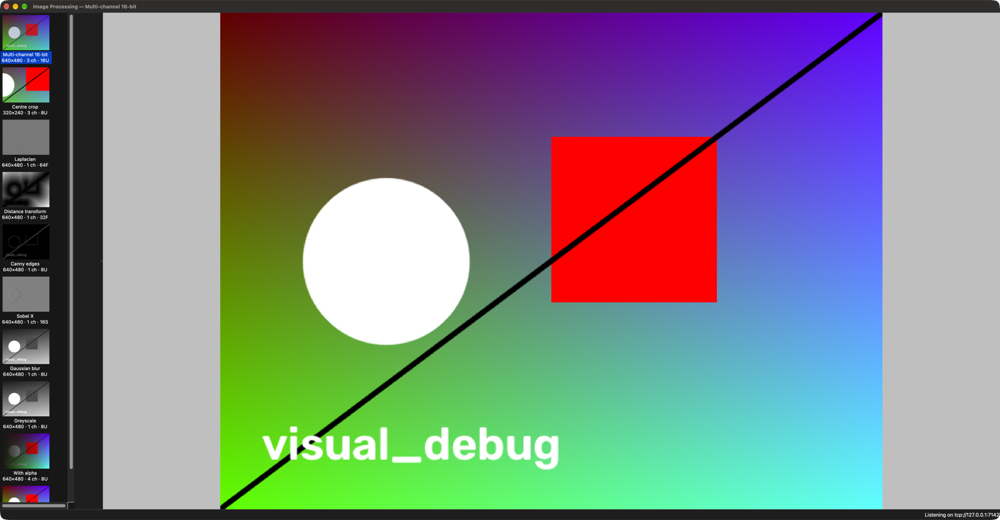
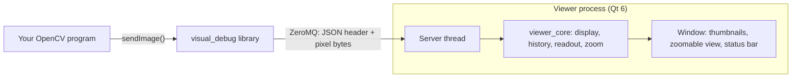
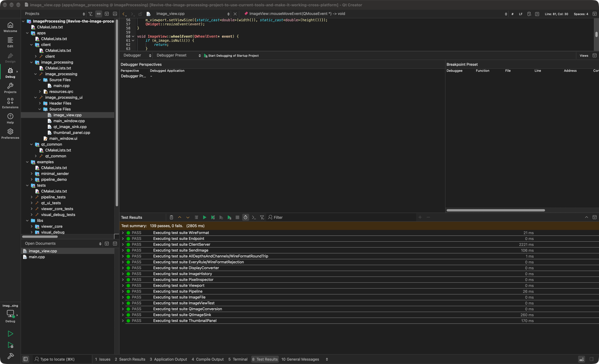

# Image Processing — a visual debugger for OpenCV

An OpenCV program calls one function, and the image appears in a separate viewer window, where you can
zoom into it, pan around and read the original value of any pixel, whether it is 8-bit, 16-bit, signed or
floating point.

```cpp
#include "visual_debug/send_image.h"

visual_debug::sendImage(edges, "Canny edges");   // returns quickly if no viewer is running
```



This started as my bachelor's thesis in 2013, written for Qt 4 and OpenCV 2.4 on Ubuntu. In 2026 I
brought it back: ported to Qt 6 and OpenCV 5, restructured, tested and documented. What changed, and why,
is [below](#what-changed-since-2013).

## How it works



- The **`visual_debug`** library is all a program needs. It depends on OpenCV, ZeroMQ and a header-only
  JSON library, **never Qt**, so it fits into any OpenCV application.
- The **viewer** is a separate Qt 6 app. If it is not running, a send fails within half a second the first
  time and instantly after that, and the program carries on. Start the viewer later and images arrive again.
- The message is a small **JSON header** that describes the image, followed by the **raw pixels**. New
  fields can be added without breaking older viewers. See the [wire format](docs/wire-format.md).
- The viewer listens on **this machine only** unless told otherwise.

## Quick start (macOS)

From a clone of this repository, with [Homebrew](https://brew.sh) installed:

```sh
brew install cmake ninja pkgconf qt opencv zeromq cppzmq nlohmann-json googletest
cmake --preset debug
cmake --build --preset debug
open build/debug/apps/image_processing/image_processing.app
build/debug/examples/pipeline_demo/pipeline_demo
```

`open` returns before the viewer is ready, so wait until its status bar says
`Listening on tcp://127.0.0.1:7139` before running the last command. That command runs an OpenCV pipeline
and sends ten images to the viewer: colour, alpha, greyscale, signed 16-bit, 32- and 64-bit floating
point, a cropped region and 16-bit colour. Hover over them to see the original values.

## Everyday commands

Run these from the repository root. The [build guide](docs/build-guide.md) and the
[user guide](docs/user-guide.md) explain each one in full.

### Configure, build and test

```sh
cmake --preset debug                    # configure; once, or after changing a CMakeLists.txt
cmake --build --preset debug            # build everything into build/debug
ctest --preset debug                    # all 139 tests, about 6 seconds
ctest --preset debug -R ClientServer    # only the tests whose name matches
```

Swap `debug` for `release`, or for `asan` to run the same tests under AddressSanitizer and
UndefinedBehaviorSanitizer.

### Run the programs

```sh
# The viewer. Double-clicking image_processing.app in Finder works too.
open build/debug/apps/image_processing/image_processing.app

# An OpenCV pipeline that sends each of its ten stages; give it a path to use your own image
build/debug/examples/pipeline_demo/pipeline_demo

# The demo sender: click Open… to pick an image, then Send image
open build/debug/apps/client/client.app

# The smallest sender: three thresholded images
build/debug/examples/minimal_sender/minimal_sender
```

Senders started before the viewer's status bar says `Listening on tcp://127.0.0.1:7139` get
`ViewerUnavailable` and carry on; later sends reach the viewer once it is up.

In the viewer, the mouse wheel zooms, dragging pans, a double-click fits the image to the window again,
and hovering shows the original value of the pixel under the cursor. **File → Open…** adds an image file
to the history and **File → Save As…** saves the displayed image.

```sh
# A second viewer on another port, and a sender aimed at it
open -n build/debug/apps/image_processing/image_processing.app --args --endpoint tcp://127.0.0.1:7140
build/debug/examples/pipeline_demo/pipeline_demo --endpoint tcp://127.0.0.1:7140

# Run the viewer in the terminal to see its options, or its log as it runs
build/debug/apps/image_processing/image_processing.app/Contents/MacOS/image_processing --help
```

### Build, test and debug in Qt Creator

1. **File → Open File or Project…** and choose the top-level `CMakeLists.txt`.
2. Tick the **Debug** preset and click **Configure Project**. Qt Creator uses the same `build/debug` folder
   as the command line, so either can build it.
3. **⌘B** builds. Pick `image_processing` in the run target selector (the computer icon at the bottom left)
   and press **⌘R** to run it.
4. **Tools → Tests → Run All Tests** runs every test; the results appear in the **Test Results** pane.
   Unlike `ctest`, Qt Creator runs all the tests of one test program in a single process.
5. Click in the margin next to a line to set a breakpoint and press **⌘Y** to debug with LLDB. The first
   time, macOS may ask for your password to let the debugger attach.



## Documentation

| Document | Contents |
|---|---|
| [Build guide](docs/build-guide.md) | Installing the tools, presets, targets, running the tests, Qt Creator, troubleshooting |
| [User guide](docs/user-guide.md) | Running each program, viewer controls, configuration, send results, six worked examples |
| [Wire format](docs/wire-format.md) | The message format, validation rules and replies, for writing a sender in any language |
| [Architecture](docs/architecture.md) | Components, dependency rule, threads, transport behaviour, extension points |
| [ADR-001](docs/ADR/ADR-001-technology-stack.md) | Why C++20, Qt 6, ZeroMQ, JSON and GoogleTest |

## What changed since 2013

### The toolchain, then and now

| | 2013 | 2026 |
|---|---|---|
| Platform | Ubuntu | macOS on Apple silicon (Windows and Linux next) |
| UI | Qt 4.8.1 | Qt 6 |
| OpenCV | 2.4, with C-era names such as `CV_LOAD_IMAGE_UNCHANGED` | 5.0, using only API that also exists in 4.x |
| C++ | pre-C++11 style: `0` for null, manual `new` and `delete` | C++20 |
| Build | three qmake `.pro` files with hard-coded build paths | one CMake project with presets, warning-free under `-Wall -Wextra -Wpedantic` |
| Message | a hand-packed binary header | a JSON header plus a pixel frame, validated field by field |
| Tests | none | 139 GoogleTest tests, also run under AddressSanitizer and UndefinedBehaviorSanitizer |
| Documentation | one paragraph in `readme.txt` | this README, four guides and a decision record |

### Defects found in the 2013 code, and what fixed them

1. **A program froze if no viewer was running**, and every image opened a new ZeroMQ connection. Now one
   connection per client, a reply timeout, a retry back-off and automatic recovery.
2. **The viewer listened on every network interface and trusted the lengths in the header**, so anyone on
   the network could make it read out of bounds. Now loopback only by default, and every field is
   validated before use.
3. **Images with an alpha channel crashed the viewer.**
4. **Multi-channel images deeper than 8 bits crashed it too.** A single display converter now handles
   every depth and channel count.
5. **The pixel readout showed the scaled 8-bit copy**, not the real values, and signed 8-bit images were
   shown as unsigned. It now reads the original.
6. **A cropped region (`image(rect)`) arrived garbled**, because the row stride was not sent. The sender now
   makes such images contiguous first.
7. **The receive thread could only be stopped by killing it.** It now checks a stop flag.
8. **The window could not grow beyond 1366×768.**
9. **The Save action did nothing**: it was defined but never connected. **File → Save As…** now works.
10. **The library depended on Qt** only for an export macro, and its header was copied into the client.
    It is now a Qt-free library with one set of headers.
11. Leftovers: a hard-coded `/home` folder in the file dialog, Symbian and Maemo sections, an unused
    signal. Removed.
12. **Negative cursor coordinates were not checked.** The readout now checks bounds.

### From Slovak to English

Many of the thesis code's names were Slovak. The client lived in `klient/`, the icons in `Obrazky.qrc`
under the prefix `/zakladne` ("basic"), the image label was `lbl_obrazok`, an image's name, width and
height were `nazov`, `sirka` and `vyska`, and every sent image was called `môj obrázok č.1` ("my picture
no. 1"). Now it is `apps/client/`, `resources.qrc` with `/icons`, `previewLabel`, the JSON
fields `name`, `cols` and `rows`, and images are named after their file: `photo.png #1`.

## Project layout

```
Image_processing/
├── libs/
│   ├── visual_debug/      the sender library and the viewer's server (no Qt)
│   └── viewer_core/       the viewer's logic: display, history, pixel readout, zoom (no Qt)
├── apps/
│   ├── image_processing/  the viewer (Qt 6)
│   ├── client/            a demo sender (Qt 6)
│   └── qt_common/         Qt helpers shared by both apps
├── examples/
│   ├── pipeline_demo/     an OpenCV pipeline that sends every stage
│   └── minimal_sender/    the smallest use of sendImage()
├── tests/                 GoogleTest tests for all of the above
├── resources/icons/       application icons
├── docs/                  guides, wire format, architecture, decision records
├── cmake/                 warning and sanitizer settings
├── CMakeLists.txt
└── CMakePresets.json      debug, release and asan builds
```

## Status

Builds and passes all tests on macOS with Apple silicon. Windows support (vcpkg, presets and a setup
script) is the next step; the code is already written to be portable. Linux build steps are in the build
guide but not yet verified.
