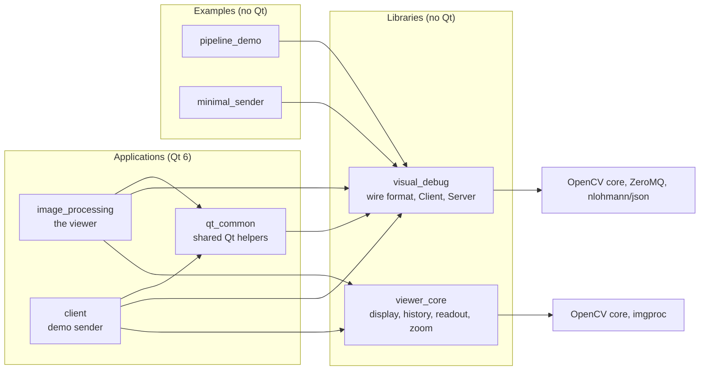
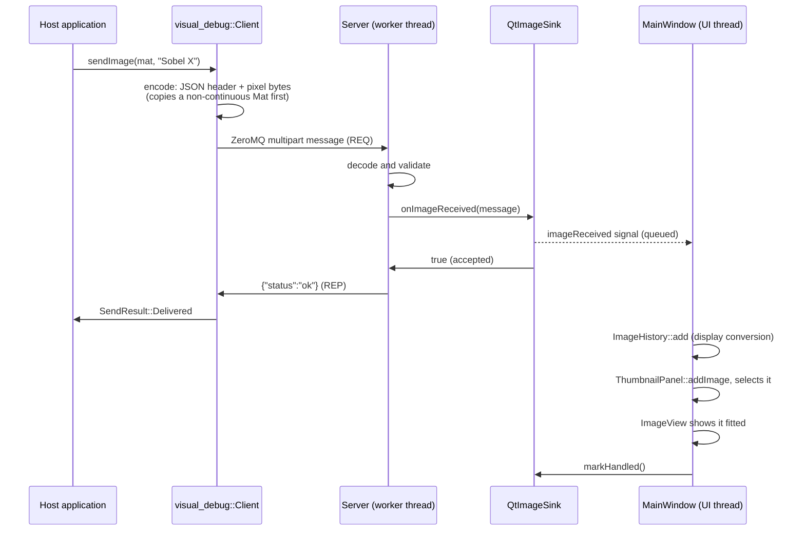

# Architecture

How the parts fit together, which way dependencies point, what runs on which thread, and where to extend
it. For the message format itself, see [`wire-format.md`](wire-format.md); for the reasons behind the
technology choices, see [ADR-001](ADR/ADR-001-technology-stack.md).

## The idea

An OpenCV program calls one function to show an image in a separate viewer process. The program takes on
only OpenCV, ZeroMQ and a header-only JSON library, never the viewer's UI toolkit. If no viewer is
running, the call returns quickly and the program carries on.

## Components

| Component | Responsibility |
|---|---|
| `libs/visual_debug` | Everything both ends of the channel share. `wire_format`: encodes an image into the two frames and decodes them back, validating everything and never throwing. `ImageSender`: the interface a host application depends on. `Client`: its ZeroMQ implementation. `sendImage()`: the one-line convenience call, using one process-wide `Client`. `Server`: the viewer's receive loop on its own thread. `ImageSink`: the interface through which the server hands images to whoever displays them. `endpoint`: the default endpoint and the loopback check. |
| `libs/viewer_core` | The viewer's logic, free of any UI toolkit, so it is unit-tested without Qt. `toDisplayImage`: any supported image to 8-bit RGBA. `ImageHistory`: the bounded list of received images. `inspectPixel`: the readout text for one pixel of the original. `Viewport`: zoom and pan arithmetic. |
| `apps/qt_common` | The little Qt code both apps need: `toQImage` (an RGBA `cv::Mat` to a `QImage`), and choosing and reading an image file. |
| `apps/image_processing` | The viewer. `MainWindow` composes the parts; `ImageView` paints through a `Viewport`; `ThumbnailPanel` shows the history; `QtImageSink` moves images from the server thread to the UI thread. |
| `apps/client` | A demo sender. Its window takes an `ImageSender&`, so it never knows which transport is behind it. |
| `examples/pipeline_demo` | An ordinary OpenCV program that sends each stage of a pipeline. Its stages are a separate `pipeline` library so tests can check them. |
| `examples/minimal_sender` | The smallest use of `sendImage`, compiled so the user guide's first example cannot go stale. |

## The dependency rule

Dependencies point one way: applications and examples depend on the libraries, never the reverse.

- **Neither library includes a Qt header or links Qt.** A host application embedding `visual_debug` must
  not inherit Qt, which is large and could clash with its own Qt version.
- `visual_debug` and `viewer_core` do not depend on each other.
- Only `qt_common` and the apps may use Qt.

CMake enforces this: each library's `CMakeLists.txt` links only OpenCV, ZeroMQ and nlohmann/json;
`qt_standard_project_setup()` and automatic `moc`, `uic` and `rcc` are switched on in `apps/CMakeLists.txt`
only; and configuring with `-DIMAGE_PROCESSING_BUILD_QT_APPS=OFF` never looks for Qt, yet builds both
libraries, both examples and their tests. Library code that uses Qt fails to link in that build. A bare
Qt `#include` may still compile, because Homebrew puts Qt's headers in the same shared include folder as
ZeroMQ's, so code review has to catch those.

## One image, end to end

The reply goes back as soon as the sink accepts the image, before the UI has drawn it, so a sender never
waits for painting.

## Threads

| Thread | Runs |
|---|---|
| The host application's thread | `Client::send` or `sendImage`. `sendImage` serialises calls from several threads behind a mutex; a `Client` is used from one thread at a time. |
| The server's worker thread | `Server`'s receive loop: polls the socket every 100 ms, decodes, calls `ImageSink::onImageReceived`, replies. It checks a stop flag on each poll, so `stop()` returns promptly without killing the thread. |
| The viewer's UI thread | Everything in `viewer_core` and all widgets. Nothing there needs a lock. |

`ImageSink::onImageReceived` is called **on the worker thread**; every sink is responsible for getting the
image to its own UI thread. `QtImageSink` emits a signal connected with `Qt::QueuedConnection`, so the slot
runs on the UI thread.

**Back-pressure.** At most eight images may wait for the UI. When all eight slots are taken, the worker
thread waits up to 200 ms for the UI to call `markHandled()`. A burst from a fast sender is therefore
slowed down to the UI's pace instead of being dropped, and only a UI stalled for longer makes the sender
see `Rejected` ("viewer busy"). The 200 ms stays well inside the client's 500 ms reply timeout.

**Start-up order.** The viewer starts listening from its event loop, not in the window's constructor, so
it never accepts images before its UI can take them. `MainWindow` declares its `QtImageSink` before its
`Server`, so the server's thread has stopped before the sink is destroyed.

## Display rules

`viewer_core::toDisplayImage` produces what is on screen; the pixel readout always reads the original.

| Input | Display |
|---|---|
| depth `8U` | values unchanged |
| any other supported depth | min–max normalised to 0–255 across all channels together; a constant image becomes black; NaN and ±Inf are ignored for the range and shown as 0 |
| 1 channel | grey |
| 2 channels | R = channel 0, G = channel 1, B = 0 |
| 3 channels | BGR to RGB |
| 4 channels | BGRA to RGBA |

`ImageView` samples with nearest neighbour when zoomed in past 1:1, so single pixels stay sharp, and
smoothly when zoomed out. It floors view-to-image coordinates, so the point at −0.5 is pixel −1 (outside
the image), not pixel 0.

## Transport behaviour

The client follows ZeroMQ's "Lazy Pirate" pattern for a request–reply channel that must survive a missing
or restarting peer:

- **No viewer.** Only the first send on a new socket waits (up to `replyTimeout`, 500 ms) for a connection;
  every later send checks with a zero timeout. A failure starts a back-off (`retryInterval`, 1 s) during
  which sends return `ViewerUnavailable` at once. A host application is thus blocked once, for half a
  second, not on every image.
- **Viewer appears later.** The socket is kept after `ViewerUnavailable`; ZeroMQ reconnects it in the
  background, so the first send after the back-off is delivered.
- **Reply lost.** After `Timeout`, the socket is closed and recreated, because a REQ socket still waiting
  for a reply cannot send again. The deadline is `replyTimeout` plus 10 ms per MiB, so a large image is
  not mistaken for a lost one.
- **Never throws.** Every ZeroMQ or JSON error becomes a `SendResult`.

The server binds to loopback only unless `allowRemote` is set, limits frame size and queue length, replies
only with fixed ASCII reasons, and survives any malformed message. Details are in
[`wire-format.md`](wire-format.md#validation).

## Extension points

- **A new header field** (for example `timestamp` or `overlays`): add it in `encode` and read it in
  `decode` as optional. Older viewers ignore unknown fields, so `version` stays 2; follow the
  [versioning rule](wire-format.md#versioning-rule) and update `wire-format.md`.
- **A new sink**: implement `visual_debug::ImageSink` and pass it to a `Server`. A recording sink that
  writes images to disk, or a viewer in another toolkit, needs nothing else from the library.
- **A new sender**: implement `visual_debug::ImageSender` (for example a shared-memory transport for very
  large frames). Code written against `ImageSender&`, like the client's window, works with it unchanged.
- **A new pipeline stage**: add an entry to `buildPipeline()` in `examples/pipeline_demo/pipeline.cpp`;
  see the [user guide](user-guide.md#4-add-a-stage-to-pipeline_demo).
- **Viewer features** (histograms, overlays, filters): put the logic in `viewer_core` with unit tests, and
  keep the Qt side to drawing and input.
